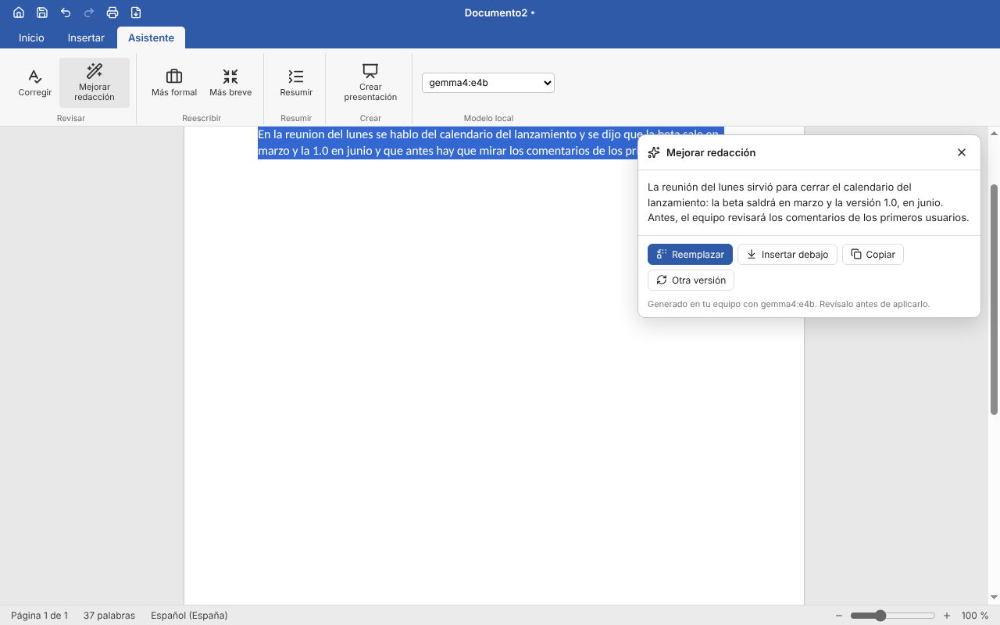
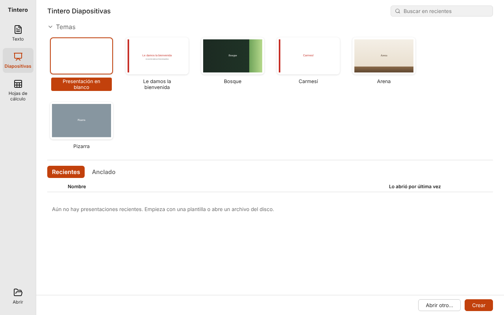
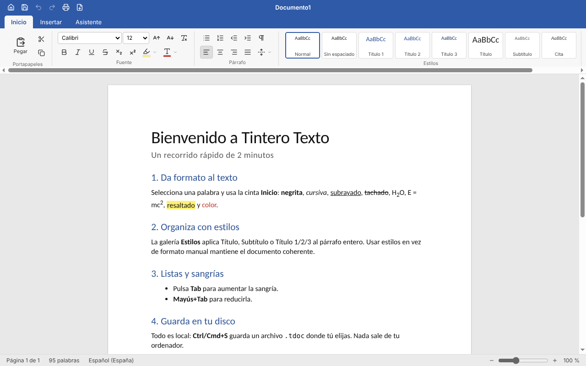
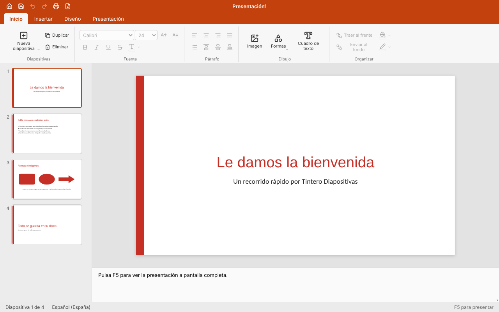
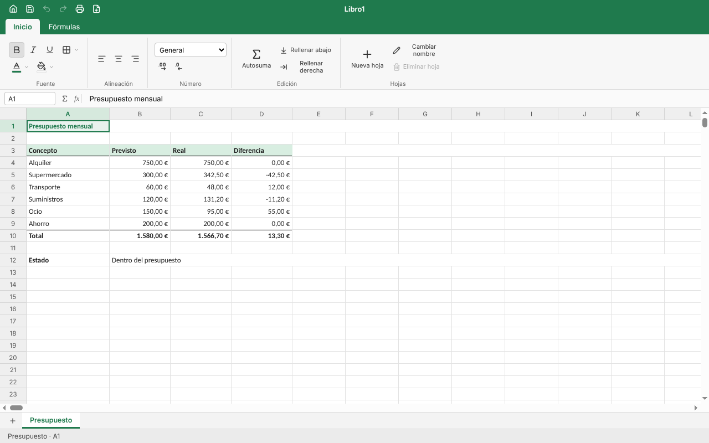
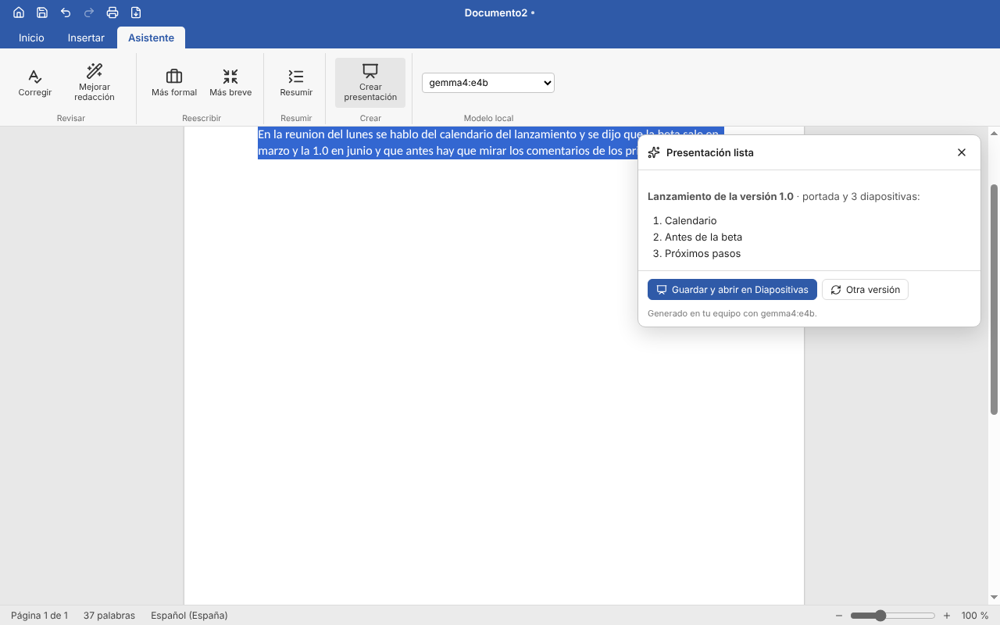
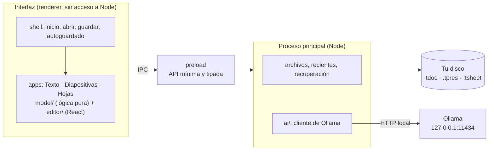

<p align="center">
  
</p>

<h1 align="center">Tintero</h1>

<p align="center">
  Suite ofimática de escritorio <strong>100 % local</strong>: texto, presentaciones y hojas de cálculo,<br>
  compatible con Office y con una IA que funciona en tu equipo. Sin nube, sin cuentas.
</p>

<p align="center">
  <a href="https://github.com/tonelo2244/tintero/actions/workflows/ci.yml"></a>
  <a href="https://github.com/tonelo2244/tintero/releases/latest"></a>
  
  
</p>



## En dos minutos

**Qué es.** Una alternativa ligera a Office para Mac, Windows y Linux, hecha con Electron, React y
TypeScript. Tus archivos se quedan en tu disco y la IA (Ollama) se ejecuta en tu ordenador.

**Qué hay que mirar si revisas el código:**

| Si te interesa…            | Mira                                                                                                                                       |
| -------------------------- | ------------------------------------------------------------------------------------------------------------------------------------------ |
| Arquitectura extensible    | [`AppModule`](src/renderer/src/core/appModule.ts): cada app es un módulo; Hojas de cálculo se añadió sin tocar el proceso principal        |
| Algoritmos propios         | El [motor de fórmulas](src/renderer/src/apps/sheets/model/formula) (tokenizer, parser, evaluador) y el recálculo con grafo de dependencias |
| IA aplicada con criterio   | [IA local](#ia-local-sin-nube): salida estructurada con JSON Schema, validación y reintento, streaming y "solo local" impuesto en código   |
| Interoperabilidad          | Lectura y escritura de .docx, .pptx y .xlsx, y [qué se pierde](#qué-se-pierde-en-cada-conversión) en cada conversión, documentado          |
| Calidad y flujo de trabajo | 200+ tests unitarios, [pruebas e2e](#cómo-se-prueba) que arrancan la app en CI, ESLint/Prettier con pre-commit y un PR por funcionalidad   |
| Seguridad de Electron      | `contextIsolation`, `sandbox`, CSP estricta y una API mínima en el preload                                                                 |

Los cambios por versión están en el [CHANGELOG](CHANGELOG.md) y lo que viene en la [hoja de ruta](docs/ROADMAP.md).

## Capturas

| Pantalla de inicio                                                | Tintero Texto                                                       |
| ----------------------------------------------------------------- | ------------------------------------------------------------------- |
|  |                            |
| **Tintero Diapositivas**                                          | **Tintero Hojas de cálculo**                                        |
|            |  |
| **IA: mejorar la redacción**                                      | **IA: crear una presentación desde el documento**                   |
|          |      |

Las capturas se generan con la app real (`npm run capturas`); las de IA usan un modelo simulado
para que salgan iguales en cualquier equipo.

## Qué incluye

- **Tintero Texto**: procesador de textos con asistente de **IA local** (ver [IA local](#ia-local-sin-nube)), cinta _Inicio_ (fuente, tamaño, negrita, cursiva, subrayado, tachado, subíndice/superíndice, color de fuente y resaltado, viñetas, numeración, sangría, alineación, interlineado, galería de estilos Normal / Título 1-3 / Título / Subtítulo / Cita), pestaña _Insertar_ (tabla, imagen, línea, fecha, cita, código), pestaña contextual _Tabla_ (filas, columnas, combinar y dividir celdas, fila de encabezado), buscar y reemplazar (Cmd/Ctrl+F), barra de estado con páginas, palabras y zoom.
- **Tintero Diapositivas**: editor de presentaciones con miniaturas reordenables, diseños de diapositiva (título, título y contenido, sección…), cuadros de texto con formato por palabra, imágenes, formas, notas del orador, 5 temas, deshacer/rehacer y modo presentación a pantalla completa (F5).
- **Tintero Hojas de cálculo**: cuadrícula de 10.000 filas × 702 columnas (A–ZZ), barra de fórmulas, motor de fórmulas propio con 48 funciones en español o inglés (SUMA, SI, BUSCARV, BUSCARX, INDICE/COINCIDIR, SUMAR.SI.CONJUNTO, fechas, TEXTO…) y columnas enteras (`A:A`), recálculo automático, referencias entre hojas, modo señalar (clic en una celda mientras escribes una fórmula), formato de número (número, moneda, porcentaje, fecha), negrita/cursiva/subrayado, colores, bordes, alineación, ancho de columna, varias hojas, copiar/pegar con referencias relativas, rellenar (Ctrl+D/R), autosuma y suma/promedio/recuento de la selección en la barra de estado. Insertar y borrar filas o columnas (las fórmulas de todo el libro se reescriben), cortar y pegar que actualiza las fórmulas, ordenar por varias columnas, autofiltro, buscar y reemplazar en la hoja o el libro, inmovilizar paneles, alto de fila, ajustar texto, celdas combinadas, formato condicional, gráficos de columnas, líneas y circular (SVG propio) e impresión ajustada al ancho.

Las tres comparten una pantalla de inicio con plantillas/temas, **Recientes** y **Anclado**, y guardan en tu disco (`.tdoc`, `.tpres` y `.tsheet`).

## Requisitos y arranque

- Node.js 22 (la versión está en `.nvmrc`: `nvm use`)

```bash
npm install
npm run dev        # abre la app en modo desarrollo (recarga en caliente)
npm test           # tests unitarios (Vitest)
npm run test:e2e   # pruebas de extremo a extremo (compila y arranca la app con Playwright)
npm run typecheck  # comprobación de tipos
npm run build      # compila a ./out
npm run lint       # ESLint
npm run format     # Prettier (formatea todo)
```

`npm install` descarga el binario de Electron al terminar (script `postinstall`), porque
Electron ya no lo hace por su cuenta. En modo desarrollo los datos van a
`Tintero (desarrollo)`, así que puedes tener un Tintero instalado abierto a la vez.

Al hacer `git commit`, un hook de pre-commit (husky + lint-staged) pasa ESLint y Prettier sobre los archivos que vas a commitear. Cada PR ejecuta en GitHub Actions lint, formato, typecheck, tests y build.

## Instaladores

```bash
npm run dist:linux   # dist/Tintero-<versión>-x86_64.AppImage
npm run dist:win     # dist/Tintero-Setup-<versión>.exe   (hay que ejecutarlo en Windows)
npm run dist:mac     # dist/Tintero-<versión>-<arch>.dmg  (hay que ejecutarlo en macOS)
```

Cada instalador se construye en su sistema operativo, así que lo normal es dejárselo a GitHub Actions: al subir una etiqueta (`git tag v0.2.0 && git push origin v0.2.0`) el workflow _Instaladores_ construye los tres y los publica en una Release. También se puede lanzar a mano desde la pestaña _Actions_.

Los instaladores asocian `.tdoc`, `.tpres` y `.tsheet` con Tintero (doble clic para abrir) y la app usa una sola instancia: si ya está abierta, el archivo se abre en ella.

**Sin firma de código.** Firmar cuesta dinero (Apple Developer, certificado de Windows), así que de momento:

- **macOS**: la app lleva firma _ad-hoc_ (sin certificado de Apple). La primera vez, intenta abrirla y después ve a _Ajustes del Sistema → Privacidad y seguridad → Abrir igualmente_. Si aun así dice que "está dañada", ejecuta `xattr -cr /Applications/Tintero.app`.
- **Windows**: SmartScreen avisará; _Más información → Ejecutar de todas formas_.
- **Linux**: `chmod +x Tintero-*.AppImage`. El AppImage no registra la asociación de archivos por sí solo; para eso hace falta integrarlo en el escritorio (p. ej. con AppImageLauncher).

Atajos: `Cmd/Ctrl+N` nuevo, `Cmd/Ctrl+O` abrir, `Cmd/Ctrl+S` guardar, `Cmd/Ctrl+Shift+S` guardar como, `Cmd/Ctrl+P` imprimir, `Cmd/Ctrl+Shift+E` exportar a PDF, `F5` presentar.

## Compatibilidad con Office

| App          | Exportar         | Importar    |
| ------------ | ---------------- | ----------- |
| Texto        | PDF, .docx       | .docx       |
| Diapositivas | PDF, .pptx       | .pptx       |
| Hojas        | PDF, .xlsx, .csv | .xlsx, .csv |

**Exportar** (icono de descarga de la barra superior, o `Cmd/Ctrl+Shift+E` para PDF) crea una **copia**: sigues editando tu `.tdoc`/`.tpres` y el siguiente `Cmd/Ctrl+S` no sobrescribe el archivo exportado.

**Importar** (Abrir… y elegir un `.docx` o `.pptx`) abre una **copia sin guardar**: al guardar se crea un `.tdoc`/`.tpres` nuevo y el original no se toca. Un aviso dice exactamente qué no se ha podido conservar de ese archivo.

### Qué se pierde en cada conversión

- **Exportar a .docx:** el resaltado se guarda como sombreado (Word solo tiene 16 colores de resaltado); las imágenes SVG o WebP se omiten; las tablas conservan celdas combinadas, anchos de columna y fila de encabezado (que se repite en cada página); los saltos de página los decide Word.
- **Importar .docx:** se conserva la estructura (títulos, Título/Subtítulo/Cita, listas, negrita, cursiva, subrayado, tachado, sub/superíndice, enlaces, imágenes, notas al pie y tablas con celdas combinadas y fila de encabezado) y también el formato aplicado a mano: fuente, tamaño, color, resaltado y alineación. Los comentarios se ven en un panel (Insertar → Ver comentarios) y se pueden añadir, editar y borrar; el encabezado y el pie (con el número de página) se guardan en el documento y vuelven a Word al exportar. Aún no se importan cuadros de texto ni la alineación de párrafos dentro de listas.
- **Exportar a .docx** también escribe el encabezado, el pie con los campos de número de página y los comentarios.
- **Exportar a .pptx:** posiciones, textos, formas, imágenes, tablas, giros, fondos propios y notas pasan tal cual. El fondo del tema se reconstruye con franjas de color sólido (un degradado suave queda de su color medio) y los cuadros vacíos se omiten. PowerPoint mide el texto a su manera, así que un texto muy justo puede saltar de línea en otro sitio.
- **Exportar a .xlsx:** valores, fórmulas (con su resultado calculado, para que los visores que no recalculan lo vean), varias hojas, negrita/cursiva/subrayado, colores, bordes finos, alineación, formatos de número, anchos de columna y celdas combinadas. También fuentes y tamaños, alto de filas, ajuste de texto, paneles inmovilizados y formato condicional. Aún no se exportan gráficos ni filtros (ExcelJS no sabe escribir gráficos). Una referencia circular se guarda sin resultado (Excel muestra su propio aviso).
- **Importar .xlsx:** se conserva lo mismo que al exportar, incluido el formato condicional de los cinco tipos que tiene Tintero (mayor que, menor que, entre, texto que contiene y escala de dos colores). Se pierden (y el aviso lo dice): las demás reglas de formato condicional, validación de datos, gráficos, tablas dinámicas (quedan sus valores), comentarios, imágenes, macros, colores del tema, alineación vertical y formatos de número personalizados. Las funciones que Tintero aún no tiene (p. ej. SUMAPRODUCTO) se conservan en la fórmula pero muestran `#¿NOMBRE?`.
- **CSV:** exporta los **valores** de la hoja activa con el estándar RFC 4180 (`,` y punto decimal, UTF-8 con BOM para que Excel respete las tildes). Al importar se detecta el separador: con `;` (el CSV del Excel español) se entiende la coma decimal. Un campo que empieza por `=` se importa como texto y no como fórmula, para evitar la [inyección de CSV](https://owasp.org/www-community/attacks/CSV_Injection).
- **Importar .pptx:** se conservan posiciones, tamaños, textos con su formato por palabra (negrita, cursiva, subrayado, tachado, tamaño, fuente y color), alineación y viñetas, 7 formas, imágenes PNG/JPEG/GIF/BMP, grupos, giros, tablas y notas, siguiendo la herencia diapositiva → diseño → patrón. Los colores, fuentes y fondo del archivo se convierten en un tema **Importado** (el primero de la galería de Diseño), y los fondos propios de cada diapositiva se respetan. Se pierden gráficos y SmartArt, el estilo de tabla de PowerPoint (bandas y bordes), las celdas combinadas de tablas, el volteo, animaciones y transiciones. Las demás formas pasan a rectángulo y las presentaciones 4:3 se centran en 16:9.

El comportamiento de cada importador se comprueba con un **corpus** de archivos escritos por otros programas (`fixtures/office/`, generado con python-docx, openpyxl, python-pptx y LibreOffice por `fixtures/office/generar.py`).

## IA local (sin nube)

Cada app tiene una pestaña **Asistente**. Todo se genera en tu equipo y **nada se aplica sin que lo revises**.

- **Texto**: _Corregir_, _Mejorar redacción_, _Más formal_, _Más breve_ y _Resumir_, conservando negrita, cursiva y demás formato al reescribir. Los documentos largos se resumen por partes (_map-reduce_), sin recortarlos. **Crear presentación** convierte el documento en una presentación con portada, puntos y notas. **Preguntar a mis documentos** responde con lo que dicen tus documentos recientes y cita el documento y el párrafo de cada dato (RAG local). El clic derecho ofrece las sugerencias del **corrector ortográfico**.
- **Hojas de cálculo**: **Fórmula con IA** («suma las ventas del norte») propone la fórmula en español, la valida con el motor de fórmulas y enseña el resultado antes de insertarla; **Explicar fórmula**; **Analizar datos**, donde el código calcula las estadísticas y el modelo solo las redacta.
- **Diapositivas y Hojas**: **Pedir cambios** («pon en negrita los títulos y añade una diapositiva de conclusiones»). El modelo propone llamadas a herramientas que son las mismas acciones del editor; se ven en una lista en lenguaje llano y, si las aplicas, se deshacen todas con un solo Ctrl+Z.

### Puesta en marcha (una vez)

1. Instala [Ollama](https://ollama.com/download) y ábrelo (en Mac queda en la barra de menús).
2. Descarga un modelo en el Terminal: `ollama pull gemma4:e4b` (unos 3–4 GB).
3. En Tintero: _Asistente_ → cualquier acción. Si Ollama no está abierto o no tiene modelos, el panel te dice exactamente qué falta.
4. Para _Preguntar a mis documentos_, además un modelo de embeddings: `ollama pull embeddinggemma` (unos 600 MB).

El selector _Modelo local_ de la pestaña lista los modelos que tengas y recuerda tu elección. Si no eliges ninguno, Tintero usa el primero instalado de esta lista: `gemma4:e4b`, `qwen3.5:9b`, `qwen3.5:4b`, `gemma3:4b`, `qwen3:8b`.

### Por qué así

- **Local y no nube.** La promesa de Tintero es que tus documentos no salen del equipo; una API en la nube (Claude, GPT…) escribiría mejor y más rápido, pero rompería esa promesa y añadiría cuentas, claves y coste por uso. A cambio, en local la calidad depende del tamaño del modelo y de la memoria del equipo, y la primera petición tarda unos segundos en cargar el modelo. Para tareas acotadas (corregir, resumir, reestructurar) un modelo de 4–9B es suficiente. `assertLocalEndpoint` hace cumplir la promesa en código: el cliente solo acepta direcciones de este equipo.
- **Ollama por defecto, llama.cpp para comparar.** Ollama gestiona descargas, cuantización y aceleración por GPU (Metal en Mac) y expone una API HTTP sencilla con streaming y **salida estructurada** (JSON Schema). llama.cpp (`llama-server`) es más ligero pero obliga a gestionar binarios y archivos de modelo a mano. Los dos implementan el contrato `LocalModelRuntime`; `TINTERO_AI_RUNTIME=llamacpp` cambia el de la app y `npm run eval -- --runtime llamacpp` permite compararlos con números.
- **Gemma 4 E4B por defecto.** Buen español, sigue bien instrucciones y JSON, y cabe holgado en un portátil con 16 GB. Con más memoria, `qwen3.5:9b` escribe mejor a cambio de algo más de lentitud.
- **La IA se llama desde main, no desde la interfaz.** El renderer no tiene red (CSP `default-src 'self'`) ni debería tenerla; main centraliza el endpoint, la cancelación y la regla de "solo local". Pero main **no sabe de documentos**: recibe mensajes y devuelve texto. Los prompts y la validación viven en cada app (`writer/model/ai`, `slides/model/outline.ts`), igual que la conversión a .docx vive en Texto y main solo escribe bytes.
- **Salida estructurada + validación + reintento.** Para crear la presentación el modelo devuelve JSON con un esquema (título, diapositivas, puntos, notas) y no diapositivas: posiciones y estilos los pone el código con las mismas fábricas que el editor, así un error del modelo nunca produce un archivo roto. `parseOutline` valida; si falla, `generateStructured` reintenta enseñándole al modelo su respuesta y el error concreto.
- **Medido, no a ojo.** `npm run eval` ejecuta un banco de casos contra un modelo real y da aciertos, JSON válido a la primera, reintentos y latencia p50/p95: comprobaciones deterministas donde se puede (la fórmula da el número esperado, el estado final de la presentación es el pedido) y un juez LLM con rúbrica solo donde no. Ver [evals/README.md](evals/README.md).
- **El modelo propone, el código decide.** Una fórmula pasa por el parser y se calcula antes de insertarla; una llamada a herramienta pasa por el reducer, y si no cambia nada o no es válida se descarta y se le pide al modelo que lo corrija; las cifras de un análisis las calcula el código y se avisa si el texto menciona alguna que no sale de los datos.
- **RAG sencillo a propósito.** Embeddings con Ollama (`/api/embed`) y búsqueda por similitud coseno en memoria sobre un índice en `userData`: con cientos de documentos es instantáneo y no añade dependencias nativas (SQLite + `sqlite-vec` es el siguiente paso si crece). El servicio de main es genérico; qué se indexa y cómo se trocea lo decide Texto. Solo se recalcula lo que cambió (huella del contenido), y las citas se comprueban: un `[7]` cuando hay 5 fragmentos se quita.
- **El texto del usuario va como datos.** Los prompts lo delimitan (`<texto>…</texto>`) y piden no seguir instrucciones de dentro. No es infalible (inyección de prompt), por eso nada se aplica sin tu revisión.
- **Corrector ortográfico:** en macOS es el del sistema (local, con tu diccionario). En Windows y Linux Chromium descarga una vez el diccionario de español e inglés; después funciona sin conexión y nunca envía tu texto.

```
renderer (Texto)                     preload                  main
writingActions / outline  ──►  platform.ai.generate  ──IPC──►  AiService ──► LocalModelRuntime ──HTTP──► Ollama (127.0.0.1:11434)
  prompts + validación          ◄── trozos (ai:token) ◄──────   cancelar, elegir modelo   (Ollama o llama.cpp)
documentChunks / askDocuments ─►  platform.rag.search ──IPC──►  RagService ──► /api/embed + índice en userData
```

## Stack y por qué

| Pieza            | Elección                                                  | Motivo                                                                                                                                                                                |
| ---------------- | --------------------------------------------------------- | ------------------------------------------------------------------------------------------------------------------------------------------------------------------------------------- |
| Escritorio       | **Electron**                                              | Acceso a disco y diálogos nativos con JavaScript/TypeScript puro. Tauri da binarios más pequeños pero exige Rust para la parte nativa: más fricción ahora mismo para aprender.        |
| Build            | **electron-vite** (Vite)                                  | Una sola configuración para proceso principal, preload e interfaz; recarga instantánea.                                                                                               |
| UI               | **React + TypeScript**                                    | Estándar de la industria; tipos estrictos en todo el proyecto.                                                                                                                        |
| Editor de texto  | **Tiptap** (sobre ProseMirror)                            | Escribir un editor de texto enriquecido desde cero es un pozo sin fondo. ProseMirror es lo que usan productos serios (NYT, Atlassian…).                                               |
| Presentaciones   | Modelo propio + reducer puro                              | No hay una librería que encaje; el modelo es simple (cajas posicionadas) y así queda 100 % testeable.                                                                                 |
| Hojas de cálculo | Motor de fórmulas propio + cuadrícula virtualizada propia | El motor (parser, evaluador, grafo de dependencias) es el corazón de la app y se aprende mucho escribiéndolo; queda puro y con tests. ExcelJS solo se usa para leer y escribir .xlsx. |
| Iconos           | lucide-react                                              | Iconos libres, sin marcas registradas.                                                                                                                                                |
| Tests            | Vitest                                                    | Misma configuración que Vite.                                                                                                                                                         |

## Arquitectura



```
src/
├── shared/            Contratos compartidos por los dos procesos
│   ├── ipc.ts         API tipada entre Node y la interfaz
│   ├── ai.ts          Contrato de la IA local (mensajes, esquema JSON, estado, streaming)
│   └── document.ts    Formato de archivo (sobre versionado + contenido de cada app)
├── main/              Proceso principal (Node): NO conoce las apps
│   ├── fileService.ts Lectura/escritura atómica
│   ├── recentsStore.ts Recientes y anclados en userData/recents.json
│   ├── ai/            IA local: cliente de Ollama, elección de modelo, cancelación (sin prompts)
│   ├── spellcheck.ts  Corrector ortográfico y menú del clic derecho
│   ├── ipcHandlers.ts Traduce IPC → servicios
│   └── menu.ts        Menú nativo y atajos
├── preload/           Puente seguro (contextIsolation + sandbox)
└── renderer/src/
    ├── core/          Piezas genéricas: contrato AppModule, historial, fechas, ai/ (salida estructurada)
    ├── shell/         Pantalla de inicio y ciclo de vida del documento (crear/abrir/guardar)
    ├── ui/            Componentes reutilizables: EditorLayout, cinta, selector de color
    └── apps/
        ├── index.ts   ← registro de apps instaladas
        ├── writer/    model/ (datos y estilos) · editor/ (React + Tiptap) · templates
        ├── slides/    model/ (tipos, reducer puro, geometría, temas) · editor/ (React)
        └── sheets/    model/ (celdas, motor de fórmulas, recálculo, CSV, xlsx) · editor/ (cuadrícula, barra de fórmulas)
```

Ideas clave:

1. **Cada app es un módulo** que cumple la interfaz `AppModule` (`core/appModule.ts`): id, nombre, extensión de archivo, plantillas, `parseContent` y su componente `Editor`. El inicio, los recientes, abrir/guardar y los atajos funcionan para cualquier app registrada.
2. **El proceso principal es agnóstico**: solo lee y escribe archivos. Añadir una app no toca `main/`.
3. **Lógica separada de la presentación**: el reducer de presentaciones, la geometría (mover/redimensionar/imantar), el historial y el formato de archivo son funciones puras con tests. Los componentes React solo pintan y despachan acciones.
4. **Formato de archivo versionado**: `{ format, version, appId, savedAt, content }`. Si algún día cambia la estructura, se puede migrar.
5. **Seguridad Electron por defecto**: `contextIsolation`, `sandbox`, sin `nodeIntegration`, CSP estricta y la interfaz solo ve la API mínima del preload.

### Añadir una app nueva

1. Crea `src/renderer/src/apps/<app>/` con un `index.ts` que exporte `defineApp({...})`.
2. Añádela a la lista de `src/renderer/src/apps/index.ts`.
3. Si quieres que el sistema abra sus archivos con doble clic, añade su extensión a `fileAssociations` en `electron-builder.yml`.

Nada más: aparecerá en la barra lateral del inicio con sus plantillas y recientes. Hojas de cálculo se añadió exactamente así.

### Cómo funciona el motor de fórmulas

```
"=SUMA(A1:A3;2)"  →  tokenizer.ts  →  parser.ts (AST)  →  evaluate.ts + functions.ts  →  6
                                          │
                                          └→ printer.ts: "SUM(A1:A3,2)" (se guarda) / "SUMA(A1:A3;2)" (se ve)
```

- Las fórmulas se guardan en **forma canónica** (nombres en inglés y `,`), como hace Excel por dentro. La barra de fórmulas las muestra en español. Al escribir se aceptan los dos idiomas y los dos separadores; dentro de una fórmula los decimales van con punto (`=A1*1.21`).
- `calc.ts` mantiene un **grafo de dependencias**: al cambiar una celda solo se recalculan ella y lo que depende de ella, en orden topológico (algoritmo de Kahn, sin recursión). Lo que no se puede ordenar es un ciclo y muestra `#¡CIRCULAR!`.
- Copiar, rellenar y renombrar hojas trabajan sobre el árbol (no con expresiones regulares), así que respetan `$A$1`, textos entre comillas y nombres de hoja con espacios.
- Insertar o borrar filas y columnas, y cortar y pegar, son la misma idea ([`formula/structure.ts`](src/renderer/src/apps/sheets/model/formula/structure.ts)): se recorre el AST de **todas** las fórmulas del libro y se recolocan las referencias a la hoja que cambia. Lo borrado pasa a `#¡REF!`, un rango que pierde filas se encoge y uno en el que se insertan, crece. Excel hace exactamente esto.
- HOY y AHORA son **volátiles**: el grafo las marca y se vuelven a evaluar en cada recálculo aunque no cambie nada de lo que leen.

## Cómo se prueba

Dos niveles, cada uno para lo que hace bien:

- **Unitarios (Vitest, 200+ tests)**: la lógica pura de `model/` (motor de fórmulas, reducer de
  diapositivas, conversiones a Office, validación de la salida de la IA) y los servicios de
  `main/`. Son rápidos y dicen exactamente qué se rompió.
- **De extremo a extremo (Playwright, [`e2e/`](e2e))**: arrancan la app compilada y la usan
  como una persona: crear y guardar en las tres apps, volver a abrir desde Recientes, abrir
  .docx/.pptx/.xlsx, exportar y el asistente de IA. Son pocos a propósito (caminos críticos):
  cada uno tarda un segundo y prueba muchas piezas a la vez.

Detalles que hacen que los e2e sean fiables:

- **Ollama simulado** ([`e2e/support/fakeOllama.ts`](e2e/support/fakeOllama.ts)): un servidor
  que habla la misma API (incluido el streaming NDJSON) con respuestas fijas. Prueba la
  tubería entera sin GPU ni modelos de 4 GB en CI. La _calidad_ de las respuestas se medirá
  aparte, con evaluaciones (fase 8 de la hoja de ruta).
- **Cada prueba con su carpeta de datos** (`TINTERO_USER_DATA_DIR`): no comparten recientes ni
  copias de recuperación, y no tocan tu Tintero instalado.
- **Los diálogos nativos los contesta la prueba** sustituyendo `dialog.showSaveDialog` en el
  proceso principal, solo para la siguiente llamada.

En CI (GitHub Actions) los e2e corren en Ubuntu con `xvfb-run`, una pantalla virtual. Si
fallan, el run guarda el informe HTML con una captura del momento del fallo.

## Decisiones de diseño

Cada una está explicada en su PR, con las alternativas que se descartaron:

- **Un PR por funcionalidad y commits pequeños.** El historial cuenta cómo creció el proyecto.
- **Importar = copia sin guardar con aviso de lo perdido** ([#8](https://github.com/tonelo2244/tintero/pull/8), [#10](https://github.com/tonelo2244/tintero/pull/10)): abrir un .docx nunca lo
  sobrescribe, y el aviso dice qué no se pudo conservar en vez de perderlo en silencio.
- **Un contrato de exportadores** ([#7](https://github.com/tonelo2244/tintero/pull/7)): cada app declara sus formatos; la conversión vive en la app y el proceso
  principal solo escribe bytes.
- **Autoguardado como copia de recuperación, no sobre tu archivo** ([#4](https://github.com/tonelo2244/tintero/pull/4)): igual que Word, para que un cierre
  inesperado no te cueste trabajo pero tampoco se guarde algo que no querías.
- **Motor de fórmulas propio** ([#13](https://github.com/tonelo2244/tintero/pull/13)): fórmulas guardadas en forma canónica (inglés y `,`) y mostradas en
  español; recálculo incremental con el algoritmo de Kahn. ExcelJS solo para leer y escribir .xlsx.
- **IA local con salida estructurada** ([#14](https://github.com/tonelo2244/tintero/pull/14)): el modelo devuelve un esquema (JSON) y el código construye
  las diapositivas, así un error del modelo nunca produce un archivo roto. Nada se aplica sin tu revisión.
- **Instaladores desde CI** ([#5](https://github.com/tonelo2244/tintero/pull/5)): cada sistema construye su instalador y una etiqueta `v*` publica la Release.

## Limitaciones conocidas (y siguiente paso natural)

Qué viene después, por fases y con prioridades: [docs/ROADMAP.md](docs/ROADMAP.md).

- **Paginación visual aproximada** en Texto: el documento es una hoja continua con marcas de salto cada A4. La paginación real es un proyecto en sí misma.
- En Diapositivas la alineación y las viñetas son del cuadro completo (el formato de carácter sí es por palabra).
- En Hojas de cálculo: no hay matrices dinámicas (BUSCARX que devuelve una fila entera da su primera celda); ajustar texto no agranda la fila sola (se ajusta arrastrando el borde de la cabecera); ordenar con un filtro activo ordena también las filas ocultas; cortar y pegar entre hojas copia en vez de mover; el formato de una columna o de la hoja entera se aplica solo a la zona con datos; los gráficos no salen al imprimir ni se exportan a .xlsx.
- Compatibilidad con Office parcial: ver la tabla de [Compatibilidad con Office](#compatibilidad-con-office).
- El autoguardado es una copia de seguridad (cada 30 s en `userData/recovery`), no guarda sobre tu archivo: para eso sigue haciendo falta Guardar.
- Instaladores sin firmar (ver [Instaladores](#instaladores)): firmar en macOS exige el Apple Developer Program.
- IA local: el asistente trabaja con texto plano, así que al reemplazar se pierde el formato de carácter de la selección (negrita, colores…); los documentos de más de 12.000 caracteres se recortan para el modelo; las fórmulas en lenguaje natural esperan a la hoja de cálculo (fase 5).
